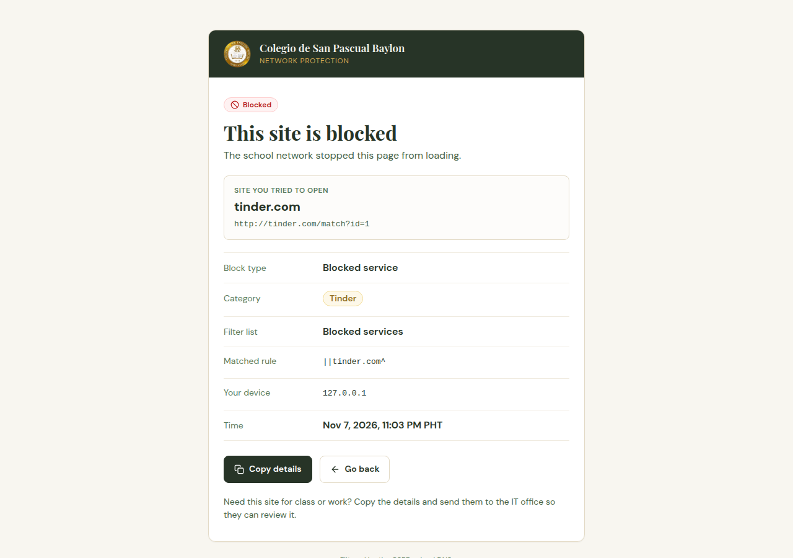
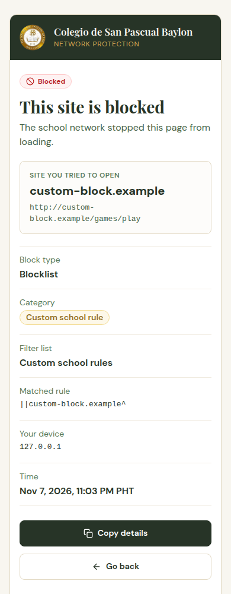

# adguard-blockpage

The page CSPB's AdGuard Home shows when someone opens a blocked site. It tells
the user **which site** was blocked, the **block type** (blocklist, blocked
service, safe browsing, parental control) and the **category** (gambling, adult
content, phishing, a named service, a custom school rule, and so on).

Styling follows the cspb-sis design system (`cspb-sis/DESIGN.md`): moss, gold
and cream, DM Sans body, Playfair Display headings.

| Desktop | Phone |
|---|---|
|  |  |

## How it works

1. AdGuard answers a blocked DNS query with this server's IP instead of `0.0.0.0`
   (`blocking_mode: custom_ip`).
2. The browser connects to this server but still asks for the blocked site, so
   the `Host` header and `location.href` name the site the user tried to open.
3. `server.py` returns `public/index.html` for every path on every host.
4. The page calls `/__blockpage/info`. The server asks AdGuard's
   `GET /control/filtering/check_host?name=<host>&client=<ip>` why that host is
   blocked for that device, maps the result to a block type and category, and
   returns JSON. AdGuard credentials stay on the server.

If the lookup fails, the page still shows the blocked site and says the details
are unavailable. If AdGuard no longer blocks the host, the page says so and tells
the user to reload in a minute.

### Categories

| AdGuard reason | Block type | Category shown |
|---|---|---|
| `FilteredBlackList`, list id 0 | Blocklist | Custom school rule |
| `FilteredBlackList` | Blocklist | From the filter list name (table below), or the list name itself |
| `FilteredBlockedService` | Blocked service | The service name, e.g. Tinder |
| `FilteredSafeBrowsing` | Safe browsing | Malware or phishing |
| `FilteredParental` | Parental control | Adult content |
| `FilteredSafeSearch` | Safe search | Safe search enforced |

Filter list name keywords, first match wins: porn/adult → Adult content,
phish → Phishing, scam → Scam, gambling → Gambling, piracy → Piracy,
dating → Dating, vpn/proxy/bypass/tor → VPN and proxy bypass, dyndns → Dynamic
DNS, nocoin/coin → Cryptojacking, malware/urlhaus/badware/threat/hacked →
Malware and security threats, AdGuard DNS filter/adaway/ads → Ads and trackers.
Edit `LIST_CATEGORIES` in `server.py` when a new list is added.

## Limitation: HTTPS

The page only appears for **plain HTTP** requests. For `https://` sites the
browser expects a certificate for the blocked domain, which this server cannot
present, so the user sees a certificate or connection error instead. Sites on the
HSTS preload list (most large sites) never fall back to HTTP. This is how every
DNS-based block page works; showing the page for HTTPS needs a TLS-intercepting
proxy with a school CA installed on every device.

## Configuration

| Variable | Default | Meaning |
|---|---|---|
| `ADGUARD_URL` | `http://127.0.0.1:3000` | AdGuard Home web/API address |
| `ADGUARD_USER` | | AdGuard user for `check_host` (Basic auth) |
| `ADGUARD_PASSWORD` / `ADGUARD_PASSWORD_FILE` | | Its password, never logged |
| `BLOCKPAGE_LISTEN` | `0.0.0.0:8080` | Bind address |
| `BLOCKPAGE_TRUST_PROXY` | `0` | `1` to read the client IP from `X-Forwarded-For` |
| `BLOCKPAGE_PROXY_IPS` | `127.0.0.1,::1` | Proxies allowed to set it; only their rightmost entry is used |

AdGuard has no read-only role, so give the block page its own AdGuard user
(`users:` in `AdGuardHome.yaml`) rather than the admin account, and keep the
env file mode 600. The info endpoint only ever looks up the request's own
`Host`, and rejects anything that is not a hostname.

## Deploy

Requirements: Python 3.9+ (standard library only), port 80 free on the chosen IP.

```bash
sudo cp -r . /opt/adguard-blockpage
sudo install -m 600 deploy/adguard-blockpage.env.example /etc/adguard-blockpage.env   # then edit
sudo cp deploy/adguard-blockpage.service /etc/systemd/system/
sudo systemctl daemon-reload && sudo systemctl enable --now adguard-blockpage
```

Or with Docker: `docker build -t adguard-blockpage .` and run it with the same
environment variables, publishing port 80 to 8080.

Then point AdGuard at it (Settings → DNS settings → Blocking mode → Custom IP, or
in `AdGuardHome.yaml` with AdGuard stopped):

```yaml
dns:
  blocking_mode: custom_ip
  blocking_ipv4: 10.116.192.41   # the block page's IPv4
  blocking_ipv6: "::"            # or the block page's IPv6
  # Safe browsing and parental answers use these hosts, not blocking_mode.
  # Not yet tested with an IP literal here; confirm with dig after the change.
  safebrowsing_block_host: 10.116.192.41
  parental_block_host: 10.116.192.41
```

Check it from a LAN client:

```bash
dig @10.116.192.41 tinder.com +short        # → 10.116.192.41
curl -s -H 'Host: tinder.com' http://10.116.192.41/__blockpage/info
```

Clients cache DNS answers, so a device may take a few minutes to see the change.

## Development

```bash
python3 -m unittest discover -s tests -v
ADGUARD_USER=... ADGUARD_PASSWORD=... BLOCKPAGE_LISTEN=127.0.0.1:8080 python3 server.py
curl -s -H 'Host: tinder.com' http://127.0.0.1:8080/__blockpage/info
```

To preview a blocked host in Chrome without changing DNS:
`google-chrome --host-resolver-rules="MAP * 127.0.0.1:8080, EXCLUDE fonts.googleapis.com, EXCLUDE fonts.gstatic.com" http://tinder.com/`.
